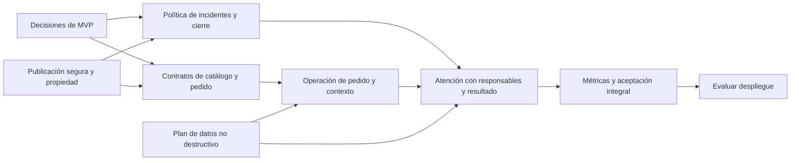

# Backlog de mejoras funcionales — SmartClaim AI

## Decisiones posteriores para Fase 2B

La solicitud del 6 de noviembre de 2026 autoriza cinco roles y reemplaza la propuesta inicial de ADMIN como operador habitual del MVP. MERCHANT prepara pedidos de establecimientos expresamente autorizados, COURIER recoge/entrega asignados y ADMIN supervisa e interviene excepcionalmente con motivo. Se confirma un establecimiento por pedido, con confirmación explícita para compras separadas y conservación del carrito restante. DELAYED nuevo se registra como incidencia separada. Los registros históricos permanecen sujetos a conciliación sin inferir eventos físicos.

La implementación y sus resultados se registran en [IMPLEMENTACION_FASE_2B.md](IMPLEMENTACION_FASE_2B.md). Se mantienen los tickets BF-06/07/12/13/17 originales y sus dependencias. Esta ampliación de roles y operación de pedidos no completa por sí misma BF-12, la administración comercial integral BF-13 ni la conciliación histórica BF-17. Los criterios y evidencia originales que siguen abajo conservan su carácter histórico.

Fecha: 30 de octubre de 2026. Base: [Auditoría funcional integral](AUDITORIA_FUNCIONAL_INTEGRAL.md). Rama auditada: `feature/optimizacion-flujo-ia`.

Este documento propone trabajo futuro. **No autoriza ni acredita implementación, migraciones o despliegue.** Los IDs AF enlazan evidencia, severidad, causas y reproducción del informe. Prioridad P0 antes de otra demostración con datos sensibles; P1 necesaria para un MVP integrado; P2 consolidación. Tamaños S/M/L son estimaciones relativas de alcance, no plazos comprometidos.

## Criterio de producto para el MVP

Un MVP coherente permite comprar productos vigentes de un establecimiento, registrar y operar manualmente el pedido, presentar sus hechos al cliente y atender varios incidentes legítimos con revisión humana y resultado explícito. Puede simular el pago si lo declara con claridad. No necesita GPS, conciliación bancaria real, microservicios, franquicias complejas, LangGraph ni roles nuevos para demostrar ese ciclo.

La arquitectura de IA optimizada se conserva: FAQ directa; reclamo explícito → clasificador existente → RAG con alcance y respaldos trazables → sugerencia → agente. El trabajo prioritario conecta esa IA con hechos comerciales y controla qué se publica.

## Decisiones de negocio antes de programar

| Decisión | Alternativas / recomendación a validar | Criterio de cierre |
|---|---|---|
| Un pedido y varios establecimientos | Recomendada para MVP: un establecimiento por pedido con confirmación al cambiar de comercio. Alternativa: separar carrito en pedidos independientes, con cargos/seguimiento por establecimiento. | Ningún artículo se atribuye a otro comercio; no eliminar el carrito sin avisar. |
| Elegibilidad temporal | Plazos por tipo de incidente y fecha base real; no fijar arbitrariamente «7/30 días». Separar demora, producto, cargo y seguridad. | Casos límite y excepciones acordados con profesor/negocio antes de codificarlos. |
| Reclamos relacionados | Reintento técnico, mismo incidente, nuevo problema y reapertura son eventos distintos. | No existe una restricción general de un único reclamo por pedido. |
| Pedido no entregado/cancelado | Retraso/no recibido puede reclamarse antes de entrega; cobro tras cancelación puede ser legítimo. | Elegibilidad explicable por incidente, no solo por estado global. |
| Resolución del caso | Separar respondido, solución propuesta, solución aceptada o cierre administrativo, sin multiplicar estados innecesarios. | Cerrar exige motivo/resultado; no implica pago o reembolso ejecutado. |
| Operador de pedidos | ADMIN opera pedidos para demo; AGENT atiende soporte. | Definir permisos de lectura/acción. No introducir COMERCIO hasta necesitar autoservicio y aislamiento por establecimiento. |
| DELAYED | Incidencia de ETA separada de fase, o estado con transiciones explícitas. | Es posible distinguir dónde está el pedido y si tiene demora. |
| Pago y compensación | Mantener simulación identificada; registrar decisiones de atención sin afirmar transacción financiera. | Los textos y datos no confirman cobro/devolución inexistentes. |
| Catálogo público | Recomendado: explorar catálogo/detalle sin login, autenticarse al confirmar. | Router, enlaces y documentación consistentes con la decisión. |
| Identidad comercial | Establecimiento con dirección/responsable como mínimo; empresa/marca/sucursal solo con casos concretos. | No se crean entidades redundantes solo para representar imágenes o etiquetas de demo. |

## Secuencia por impacto y dependencias

1. **Contener exposición y falsas certezas:** publicación de respuestas, propiedad del pedido, datos autorizados y contenido de ayuda.
2. **Definir contratos e invariantes:** cotización/comercio, máquina de estados, incidentes, identidades y precisión monetaria.
3. **Cerrar el recorrido operativo:** operador de pedidos, contexto para soporte, asignación/notificaciones y resultado del reclamo.
4. **Hacerlo administrable y medible:** catálogo, configuración efectiva, métricas consistentes y trazas accesibles.
5. **Consolidar persistencia y regresión:** migración completa, reinicio seguro, responsive, pruebas de aceptación y documentación vigente.

## Tickets propuestos

### BF-01 — Separar borrador, revisión y publicación

- **Prioridad/tamaño:** P0 · M. **Hallazgos:** AF-03, AF-04, AF-21. **Tipo:** corrección confirmada.
- **Problema:** editar una sugerencia publica de hecho texto al cliente antes de aprobar; el DTO expone información interna; reintentar aprobación duplica mensajes.
- **Alcance:** contrato cliente/staff, repositorio de respuestas, publicación atómica y UI. No cambiar el generador ni el modelo.
- **Dependencias:** ninguna para contener exposición; coordinar BF-05 para la transición definitiva.
- **Aceptación:** sugerencia/edición interna no aparece en JSON público, historial público ni UI; aprobación identifica un único evento y notifica una sola vez; fallos parciales no dejan texto «final» sin publicación.
- **Pruebas:** borrador con marcador, recarga como cliente, aprobación repetida/concurrente, rollback de fallo, permisos CLIENT/AGENT/ADMIN.

### BF-02 — Autorizar y enlazar pedidos de los reclamos

- **Prioridad/tamaño:** P0 · M. **Hallazgos:** AF-02, AF-18, AF-23. **Tipo:** corrección + saneamiento planificado.
- **Problema:** un cliente puede registrar incidentes sobre pedido ajeno o inexistente.
- **Alcance:** resolver pedido con identidad autenticada; distinguir registro staff autorizado; diseñar FK futura preservando código/snapshot. Los registros heredados sin pedido deben quedar identificados para conciliación, no borrados.
- **Dependencias:** diseño de relación con pedidos; el control de propiedad puede preceder a la migración.
- **Aceptación:** nunca se confía en `customer_email` para establecer titularidad; no se admite código inexistente salvo flujo heredado explícito de staff; fecha/responsable no se aceptan ciegamente desde cliente.
- **Pruebas:** código propio/ajeno/inexistente; cuenta inactiva; migración de copia con el reclamo huérfano observado.

### BF-03 — Cotización y alta de pedido desde catálogo autorizado

- **Prioridad/tamaño:** P0 · L. **Hallazgos:** AF-01, AF-09, AF-10, AF-11, AF-34. **Tipo:** contrato e integridad.
- **Problema:** comercio, artículos, precios y cargos los determina el navegador.
- **Alcance:** identificadores de establecimiento/productos, validación de disponibilidad y cantidades, cotización servidor, snapshots y desglose de cargos; decidir monocomercio/partición. Validar cadenas después de normalizar/trim.
- **Dependencias:** decisiones de carrito y dinero; plan de relaciones BF-17. Puede comenzar sobre catálogo actual sin nuevas jerarquías comerciales.
- **Aceptación:** precio alterado no cambia el precio autorizado; producto retirado no se compra; mismo total en carrito/confirmación/pedido; referencias útiles no se descartan silenciosamente; no se solicitan datos de pago que no se procesan.
- **Pruebas:** producto/comercio falsos, precio cero manipulado, disponibilidad modificada, espacios, cotización vencida, doble comercio y fallos durante inserción de artículos.

### BF-04 — Retirar promesas y simulaciones engañosas

- **Prioridad/tamaño:** P0 · S/M. **Hallazgos:** AF-08, AF-12, AF-15, AF-26, AF-27. **Tipo:** corrección de producto/contenido.
- **Problema:** se anuncian pagos, reembolsos, GPS, horarios/SLA y certificaciones sin respaldo verificable; el fallback parece catálogo real.
- **Alcance:** ayuda, detalle de pedido, mensajes de plantilla, catálogo/demo y contactos. No integrar pagos o GPS para justificar textos de muestra.
- **Dependencias:** definir alcance simulado y audiencia de conocimiento; no requiere esperar un rediseño de datos.
- **Aceptación:** etiquetas explícitas de simulación; sin reembolsos automáticos o correos de avance prometidos si no existe ese evento/canal; vacío/error distintos de demo; contactos operables o claramente no disponibles.
- **Pruebas:** revisión editorial de cada afirmación, catálogo 200 vacío/503 y coherencia métodos de pago ofrecidos.

### BF-05 — Máquina de estados e invariantes del reclamo

- **Prioridad/tamaño:** P0/P1 · M. **Hallazgos:** AF-20, AF-21, AF-22. **Tipo:** corrección confirmada + regla a definir.
- **Problema:** «respondido» sin respuesta y cierre con fechas incompatibles; reapertura indiferente al estado.
- **Alcance:** centralizar transiciones, actor/motivo y precondiciones; separar análisis/sugerencia/publicación de estado operativo.
- **Dependencias:** acuerdo de ciclo de atención y BF-01.
- **Aceptación:** un cerrado no revive al aprobar silenciosamente; `fecha_cierre` concuerda con estado; solo se reabre según regla; un mensaje del cliente no borra resolución anterior; reanalizar no retira la publicación vigente.
- **Pruebas:** matriz completa de transiciones/roles, aprobación tras cierre, reapertura repetida, respondido sin contenido y reanálisis con respuesta existente.

### BF-06 — Identidad y atribución de operadores

- **Prioridad/tamaño:** P1 · M. **Hallazgos:** AF-05, AF-24, AF-34. **Tipo:** integridad/auditoría.
- **Problema:** firma textual y `support` no identifican al actor; usuarios heredados y autenticados no están alineados.
- **Alcance:** elegir identidad canónica, reconciliar referencias, mantener snapshots legibles e ID estable en historial/mensajes/aprobación.
- **Dependencias:** plan BF-17; coordinar con BF-01/05.
- **Aceptación:** cada acción importante identifica al usuario autenticado y su rol; referencias históricas se conservan aunque cambie el nombre; clientes no pueden elegir un responsable arbitrario.
- **Pruebas:** dos agentes distintos, usuario desactivado, cambio de perfil, registros históricos sin actor y autorización por ID.

### BF-07 — Operación manual y seguimiento de pedidos para MVP

- **Prioridad/tamaño:** P1 · L. **Hallazgos:** AF-07, AF-08, AF-24. **Tipo:** capacidad faltante.
- **Problema:** no puede ejecutarse el escenario de preparación hasta entrega.
- **Alcance:** listado/detalle de pedidos para operador autorizado, transiciones mínimas, cancelación, timestamps e historial; actualización cliente y notificaciones. ETA declarada estimación; sin GPS.
- **Dependencias:** BF-03, BF-06 y decisión de DELAYED/cancelación.
- **Aceptación:** ADMIN puede recorrer PREPARING→IN_TRANSIT→DELIVERED; cliente no modifica estados; CANCELLED no pasa a DELIVERED; cada transición tiene responsable/fecha/motivo y resultado visible.
- **Pruebas:** escenario B real desde UI, transición inválida y concurrente, cancelación, eventos visibles desde cliente y staff.

### BF-08 — Elegibilidad y relación entre incidentes

- **Prioridad/tamaño:** P1 · M/L. **Hallazgos:** AF-18, AF-19. **Tipo:** regla de negocio + UX.
- **Problema:** todo pedido aparece igual, sin contexto temporal ni reclamos anteriores.
- **Alcance:** elegibilidad por tipo/fecha/evento, resumen de incidentes por pedido e item cuando proceda, continuar/reabrir/nuevo incidente. No imponer unicidad por pedido.
- **Dependencias:** BF-02, timestamps BF-07 y reglas aprobadas.
- **Aceptación:** pedidos muestran fecha/estado/incident count y razón de elegibilidad; demora antes de entrega y cobro tras cancelación se tratan según política; varios problemas legítimos permanecen posibles.
- **Pruebas:** pedido antiguo con excepción, frontera de plazo, incidente abierto/cerrado, problema distinto sobre mismo pedido, reclamo de artículo y notificación al titular.

### BF-09 — Idempotencia de solicitudes y altas compuestas

- **Prioridad/tamaño:** P1 · M. **Hallazgos:** AF-19, AF-21, AF-34. **Tipo:** corrección técnica.
- **Problema:** reintento técnico crea recursos o publicaciones duplicados; múltiples commits permiten persistencia parcial.
- **Alcance:** identidad de solicitud por operación, transacciones de alta/publicación y comportamiento de retry definido. No usar similitud de descripción como sustituto de idempotencia.
- **Dependencias:** contratos BF-01/03/05; decisiones de persistencia BF-17.
- **Aceptación:** la misma clave y contenido devuelve el mismo recurso; contenido distinto con la misma clave se rechaza; incidentes distintos con claves distintas siguen permitidos.
- **Pruebas:** doble clic, timeout después del commit, solicitudes simultáneas, repetición tras reinicio y rollback entre cabecera/items/historial.

### BF-10 — Contexto comercial verificado para soporte e IA

- **Prioridad/tamaño:** P1 · M. **Hallazgos:** AF-23, AF-32, AF-33. **Tipo:** integración.
- **Problema:** soporte/IA no disponen de artículos, importe y estado verificables; código desconocido se sustituye por otro pedido.
- **Alcance:** DTO autorizado de pedido/items/estado/pago simulado y documentos aplicables; separar relato del cliente y hechos del sistema; no cambiar la ruta FAQ ni el clasificador.
- **Dependencias:** BF-02/03/07 y permisos BF-06.
- **Aceptación:** agente ve el pedido real; contexto indica qué no se conoce; no confirma hechos financieros no registrados; código explícito ausente produce respuesta honesta sin usar otro recurso.
- **Pruebas:** pedido de otro usuario, código inexistente, conflicto relato/estado, artículos afectados y stubs generativos que no reciben información ajena.

### BF-11 — Resultado de atención y cierre explicable

- **Prioridad/tamaño:** P1 · M. **Hallazgos:** AF-20, AF-22, AF-08. **Tipo:** regla/capacidad faltante.
- **Problema:** el caso puede cerrarse sin registrar solución o motivo, y «respondido» se confunde con resuelto.
- **Alcance:** resultado/motivo y, si se decide, confirmación/revisión del cliente; propuesta de compensación diferenciada de compensación ejecutada.
- **Dependencias:** BF-05 y política de resolución; no depende de integrar pasarela real.
- **Aceptación:** cliente puede comprender qué se decidió y qué queda pendiente; cierre administrativo etiquetado; ninguna devolución se considera efectuada sin registro autorizado.
- **Pruebas:** cierre con/sin solución, desacuerdo/reapertura, propuesta económica pendiente y consulta del historial de resultados.

### BF-12 — Asignación, escalamiento y notificaciones operables

- **Prioridad/tamaño:** P1 · M. **Hallazgos:** AF-24, AF-25, AF-05. **Tipo:** integración.
- **Problema:** nuevo caso sin aviso al staff, escalamiento sin receptor y campana desactualizada.
- **Alcance:** responsable activo, cola no asignada, motivo/destino de escalamiento, aviso de entrada y actualización al abrir campana. ADMIN recibe escalados inicialmente.
- **Dependencias:** BF-06 y BF-05.
- **Aceptación:** caso nuevo visible/asignable; destinatario de escalado puede actuar; cliente ve nueva notificación sin recarga total; marcar una/todas no se confunde.
- **Pruebas:** asignación a usuario inactivo, cliente intenta asignar, reasignación, escalado repetido, campana 3→4 y fallo del canal sin perder mensaje.

### BF-13 — Gestión mínima de establecimientos y productos

- **Prioridad/tamaño:** P1 · L. **Hallazgos:** AF-14, AF-15, AF-01. **Tipo:** módulo nuevo justificado.
- **Problema:** catálogo de demo sin mantenimiento ni responsable comercial verificable.
- **Alcance:** ADMIN crea/edita/desactiva establecimiento/producto; dirección/responsable; disponibilidad; destacado referenciado. Evaluar empresa/sucursal solo si la demo exige varios puntos bajo el mismo operador.
- **Dependencias:** BF-03 y decisiones comerciales; requiere diseño de datos revisado, no crear tablas por adelantado.
- **Aceptación:** baja lógica no elimina snapshots de pedidos; producto pertenece al establecimiento; datos comerciales claros; rating/ETA de muestra identificados si no derivan de operación.
- **Pruebas:** permisos, cambio de precio/disponibilidad durante compra, establecimiento vacío, destacado inválido y preservación histórica.

### BF-14 — Configuración efectiva y estado real de IA

- **Prioridad/tamaño:** P1 · S/M. **Hallazgos:** AF-28, AF-29. **Tipo:** corrección confirmada.
- **Problema:** actualización por nombre con acento distinto; metadatos de modelo históricos.
- **Alcance:** una configuración efectiva identificable, actualización por ID y respuesta verificada; proveedor/modelo ejecutado separado de configuración deseada.
- **Dependencias:** conciliación de configuraciones activas BF-17; evitar borrar filas de usuario para «arreglar» semillas.
- **Aceptación:** guardar y recargar conserva cada valor; cero filas modificadas produce error claro; modelo real/fallback se informa honestamente.
- **Pruebas:** SQLite sembrada, copia con dos activas, PostgreSQL aislado, nombre modificado, valores límite y rechazo de AGENT/CLIENT.

### BF-15 — Métricas consistentes y consulta de trazabilidad

- **Prioridad/tamaño:** P1/P2 · M. **Hallazgos:** AF-30, AF-31, AF-37. **Tipo:** corrección + capacidad administrativa.
- **Problema:** filtros parciales, contadores limitados a diez y falta de vista para las trazas existentes.
- **Alcance:** diccionario de métricas/denominadores, agregados por cliente, filtros compartidos/exportables y vista ADMIN de eventos sin contenido sensible.
- **Dependencias:** definiciones de estado/resolución BF-05/11 y atribución BF-06.
- **Aceptación:** período vacío no conserva agregados globales sin rotular; 12 casos se cuentan como 12; «analizado por IA» no se llama resolución autónoma; traza permite ver FAQ/ML/RAG/fallback y duración.
- **Pruebas:** límites de paginación, filtros combinados, CSV/PDF contra API, roles, datos ausentes y redacción de PII/secrets.

### BF-16 — Experiencia robusta: navegación, carrito, ayuda y móvil

- **Prioridad/tamaño:** P1/P2 · M. **Hallazgos:** AF-13, AF-16, AF-17, AF-27, AF-37, AF-38. **Tipo:** corrección de interfaz.
- **Problema:** rutas contradictorias, JSON corrupto bloqueante, controles aparentes, errores confundidos con vacíos y contenido fuera de pantalla.
- **Alcance:** lector de carrito validado, destacado seguro, política de detalle público, búsqueda/contactos, estados carga/error/vacío y reflujo responsive; no rediseño visual general.
- **Dependencias:** decisiones de BF-04/08; puede ejecutarse incrementalmente tras contener P0.
- **Aceptación:** cada control tiene efecto verificable o estado no disponible; datos corruptos se recuperan con explicación; 320/360 px conservan acciones; login vuelve al destino acordado.
- **Pruebas:** las siete regresiones de navegador halladas, catálogo vacío/503, producto ausente, móvil con nombres/importes largos y formularios accesibles por teclado.

### BF-17 — Plan de integridad, migración y arranque seguro

- **Prioridad/tamaño:** P1 · L. **Hallazgos:** AF-02, AF-05, AF-34, AF-35, AF-36. **Tipo:** infraestructura de datos, sin sustitución de tecnologías.
- **Problema:** referencias incompletas, restricciones faltantes, migración parcial y semillas dentro del arranque.
- **Alcance:** inventario/conciliación en copia, relaciones/constraints/precisión monetaria acordadas, generación de códigos segura, migraciones no destructivas, secuencias, prueba de restauración y preparación explícita separada de inicio normal.
- **Dependencias:** contratos aprobados de BF-02/03/05/06; diseñar antes de migrar. No utilizar la base productiva como banco de pruebas.
- **Aceptación:** fixtures completas conservan usuarios/comercios/pedidos/items/reclamos/mensajes/notificaciones/evidencia; cada anomalía heredada queda conciliada o señalada; reiniciar no modifica datos ni elimina vectores.
- **Pruebas:** constraints por SQL, dinero, carga completa SQLite→PostgreSQL aislado con pgvector determinista, fallos intermedios, rollback/restore y reinicio sin escritura de demo.

### BF-18 — Fuente documental coherente y evidencia histórica

- **Prioridad/tamaño:** P2 · M. **Hallazgos:** AF-26, AF-27, AF-33. **Tipo:** política editorial/integridad.
- **Problema:** ayuda fija contradice conocimiento del motor y el snapshot documental es incompleto.
- **Alcance:** FAQ cliente aprobada, documentos internos distinguidos, categoría validada, versión/snapshot y política de edición/desactivación. Una sola fuente de conocimiento, sin duplicar respuestas en código.
- **Dependencias:** BF-04 para contención y BF-17 si se acuerdan campos de versión/audiencia.
- **Aceptación:** ayuda/chat no discrepan en reembolsos/plazos; FAQ no expone instrucciones internas; evidencia de una respuesta sigue explicable después de cambiar documentos.
- **Pruebas:** edición/desactivación, coincidencia FAQ suficiente e insuficiente, filtrado por audiencia/categoría y reconstrucción histórica sin proveedor externo.

### BF-19 — Acceso y recuperación de errores aptos para el alcance elegido

- **Prioridad/tamaño:** P1/P2 · M. **Hallazgos:** AF-06, AF-37. **Tipo:** consolidación, sin cambio obligatorio de autenticación.
- **Problema:** reset simulado y errores ambiguos; controles de despliegue todavía de prototipo.
- **Alcance:** distinguir error de conexión/credenciales, política de sesión y cuentas demo; recuperación real solo si se incorpora correo autorizado. Evaluar rate limiting y revocación según exposición.
- **Dependencias:** entorno de despliegue acordado y arranque BF-17.
- **Aceptación:** no se anuncia correo enviado si no existe envío; configuración insegura no pasa controles de producción; permisos negativos se mantienen.
- **Pruebas:** API inalcanzable, 401/403/503, usuario inactivo, expiración/cierre de sesión, cuentas demo y trazas sin secretos.

### BF-20 — Convertir la auditoría en aceptación mantenible

- **Prioridad/tamaño:** transversal · M. **Hallazgos:** AF-01 a AF-38. **Tipo:** QA/documentación.
- **Problema:** 70 tests y cinco E2E verdes no cubrían coherencia transversal.
- **Alcance:** promover escenarios confirmados del arnés temporal a regresiones mantenidas al abordar cada ticket; mantener guardas sin red y fixtures reproducibles; actualizar diccionario/documentación y etiquetar real/simulado/pendiente.
- **Dependencias:** acompaña cada cambio; no modificar expectativas para ocultar defectos del producto.
- **Aceptación:** cada ticket agrega o adapta una prueba de su criterio; se reportan aprobadas/fallidas/bloqueadas sin mezclar mocks con integración; A–I tienen resultado verificable.
- **Pruebas:** suite local sin créditos, E2E con API temporal y solicitudes externas bloqueadas; integración pgvector separada en base aislada; hashes de datos originales antes/después.

## Contrato de elegibilidad e incidentes a validar

La siguiente tabla propone comportamientos para aprobación funcional; no representa reglas ya implementadas.

| Caso | Comportamiento propuesto | Evidencia mínima |
|---|---|---|
| Reintento por red con misma clave | Devolver mismo pedido/reclamo | Clave, usuario y huella de payload. |
| Mismo problema y caso abierto | Ofrecer continuar conversación; permitir excepción motivada | Pedido, incidente, artículos y caso relacionado. |
| Mismo pedido, problema diferente | Permitir otro caso relacionado | Descripción/tipo/fecha/artículo del nuevo incidente. |
| Caso cerrado con desacuerdo | Reapertura según política o solicitud de revisión | Motivo, resultado anterior y actor. |
| Pedido no entregado con demora | Admitir atención según ETA/eventos conocidos | Estado y estimación, sin inventar GPS/entrega. |
| Cancelado con cobro pendiente | Evaluar incidente de pago; no rechazar solo por cancelación | Registro/simulación financiera claramente distinguida. |
| Pedido fuera de plazo | Explicar regla y ofrecer excepción definida | Fecha base confiable, política/versionado y motivo. |
| Pedido de otro usuario/inexistente | Rechazar sin exponer datos ajenos | Propiedad autenticada y política de respuesta. |

No se usarán solo categoría ML o similitud textual para decidir que un reclamo es duplicado. La clasificación ayuda a derivar; no establece identidad del incidente ni elegibilidad por sí sola.

## Cambios de datos potenciales, sujetos a diseño

No ejecutar DDL antes de aprobar los contratos y probar saneamiento en una copia.

- **Pedidos/items:** referencias a establecimiento/producto con snapshots; desglose de cargos/moneda/precisión y notas útiles; no almacenar referencias de pago sensibles sin necesidad.
- **Historial de pedidos:** nuevo registro justificado para fase, actor, fecha y motivo; decidir si DELAYED es incidencia separada.
- **Reclamos:** relación estable a pedido y opcional a artículos/incidente relacionado; resultado de atención y política/fecha base.
- **Respuestas:** borrador frente a publicación vigente, versión, actor y evento idempotente.
- **Identidades:** reconciliación `auth_users`/`clientes`/`usuarios`, sin eliminar historial.
- **Documentos/evidencia:** audiencia y versión/snapshot si el alcance editorial lo requiere.
- **Configuración:** una configuración efectiva y referencias por ID.
- **Establecimiento:** responsable/dirección; empresa/marca/sucursal y rol comercio solo con casos aprobados de operación multiestablecimiento.
- **Eventos financieros:** únicamente si se decide registrar conciliaciones/reembolsos; un motivo de cierre o campo `metodo_pago` no es un pago.

## Puertas de aceptación del MVP

1. **Seguridad/publicación:** AF-01/02/03/20 contenidos; pruebas negativas de titularidad y publicación pasan.
2. **Comercio:** A y B completos por UI, con importes autorizados y pago simulado visible.
3. **Atención:** C–F completos, relacionados con pedido real, incidentes legítimos múltiples, responsable y resultado entendible.
4. **Administración:** catálogo/configuración/reportes operables con permisos; G incluye trazas accesibles sin PII.
5. **Resiliencia:** H/I verificables; solicitudes repetidas y transiciones inválidas controladas; móvil y errores no bloquean al usuario.
6. **Datos:** plan no destructivo probado en copia y paridad PostgreSQL verificada en un entorno aislado antes de cualquier migración productiva.
7. **Veracidad:** ningún texto o demo se presenta como cobro, reembolso, tracking, disponibilidad o certificación no respaldada.

La aprobación de tests unitarios es una condición de regresión, no la puerta final. El MVP se considera demostrable cuando el recorrido completo y sus límites se pueden explicar y reproducir sin SQL manual ni datos ficticios ocultos.
