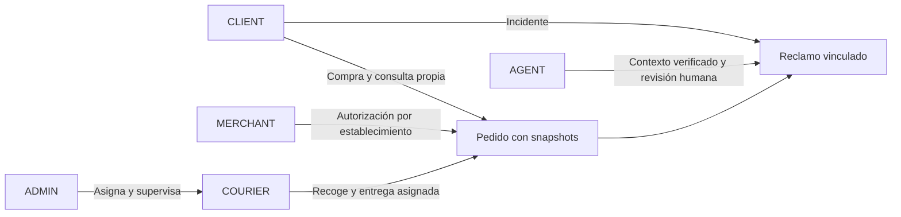
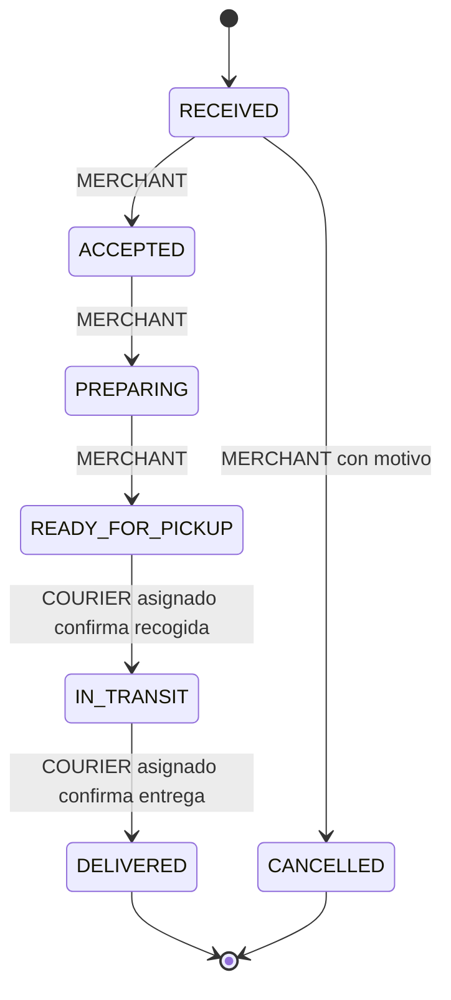

# Implementación de Fase 2B — Cinco roles y operación de pedidos

Fecha de trabajo 6 de noviembre de 2026. Rama `feature/optimizacion-flujo-ia`, base `8aa780141aaf06a8591ae08f40400fd377a1a93d`.

## Análisis y decisiones de implementación

Se revisaron la auditoría funcional integral, el backlog, Fase 1, Fase 2A y los informes de optimización y validación sin OpenAI. Se conservan los IDs existentes. Este alcance amplía BF-07 y partes de BF-06/10/13/17. BF-12 conserva su defecto AF-25 hasta una corrección específica comprobada.

La arquitectura anterior usa React/Vite/TypeScript, FastAPI, autenticación propia PBKDF2 y tokens HMAC, SQL directo sobre SQLite o psycopg/PostgreSQL, TF-IDF/Logistic Regression y RAG. La autorización consulta `auth_users` en cada solicitud, por lo que un token antiguo no conserva un rol revocado. `usuarios` es una identidad heredada distinta, utilizada por referencias antiguas de soporte. `clientes` sigue vinculado a la cuenta por correo. Esa conciliación global de identidad sigue pendiente.

La nueva operación conserva esas tecnologías. Reutiliza restaurantes, productos, cuentas, pedidos, items y reclamos con FK de Fase 1. Las relaciones nuevas representan permisos y eventos operativos, sin duplicar catálogo, identidad ni compra.

Decisiones conservadoras para este MVP, derivadas de la solicitud actual y explicitadas para revisión de negocio

- Un establecimiento por pedido. El carrito mixto se conserva y permite confirmar compras separadas. Cada pedido tiene sus propios cargos cotizados. Cancelar el diálogo conserva todos los artículos.
- El comercio puede rechazar en RECEIVED con motivo. Después de aceptar, una cancelación requiere intervención administrativa motivada. Los estados finales quedan bloqueados, incluso para ADMIN.
- Un repartidor declara disponibilidad manual. Se asigna únicamente si está activo, tiene rol COURIER, está disponible y carece de otra entrega activa. Puede consultar su historial al finalizar.
- Recogida y salida se confirman en una operación atómica READY_FOR_PICKUP → IN_TRANSIT. Entrega exige una recogida registrada.
- AGENT conserva el alcance global de atención actual y obtiene contexto exclusivamente de pedidos relacionados con reclamos. No recibe permisos de operación comercial.
- DELAYED histórico permanece intacto. No se deduce retrospectivamente una fase física. ADMIN puede conciliarlo a preparación/listo o cancelarlo con motivo. Las demoras nuevas son eventos separados de la fase.
- Las cuentas nuevas se registran como CLIENT. ADMIN puede promover una cuenta existente, conceder establecimientos y revocar autorizaciones. No se crean credenciales demo nuevas en el arranque normal.
- Al retirar MERCHANT o desactivar su cuenta se revocan sus autorizaciones activas. Restaurar solamente el rol no reactiva esos establecimientos. Retirar COURIER o desactivar la cuenta también deshabilita su disponibilidad.

## Matriz de permisos

| Operación | CLIENT | MERCHANT | COURIER | AGENT | ADMIN |
|---|---|---|---|---|---|
| Catálogo público | Sí | Sí | Sí | Sí | Sí |
| Crear pedido cotizado | Propio | No | No | No | No |
| Consultar pedidos | Propios | Establecimientos autorizados | Asignación vigente e historial propio | Vinculados a reclamos | Todos |
| Aceptar/preparar/listo | No | Establecimientos autorizados | No | No | Excepcional, con motivo |
| Recoger/entregar | No | No | Asignados | No | Excepcional, con motivo y precondiciones |
| Asignar repartidor | No | No | No | No | Listo, disponible y versión vigente |
| Incidencia de demora | No | Establecimiento autorizado | No | No | Sí |
| Leer/editar productos | Público vigente | Propios, edición solo con permiso expreso | Público vigente | Público vigente | Administración API |
| Roles/operadores/establecimiento | No | No | No | No | Sí, auditable |
| Reclamos privados/análisis/borradores | Solo DTO propio publicado | No | No | Alcance previo | Sí |
| Configuración IA/documentos | No | No | No | No | Sí |

El DTO del repartidor excluye importes, productos, identidad del cliente y reclamos. Incluye código, establecimiento, dirección de recogida conocida, destino, instrucciones, estado e historial público. Las direcciones comerciales ausentes se muestran como pendientes de registro.





ADMIN puede ejecutar el avance válido o cancelar un pedido no final mediante intervención motivada. Asignar no cambia la fase. Reportar demora conserva la fase. DELAYED heredado requiere conciliación explícita y queda fuera del flujo nuevo.

## Persistencia, concurrencia e idempotencia

- `auth_users.rol` amplía el CHECK con MERCHANT y COURIER. `pedidos.estado` amplía sus estados sin convertir registros históricos.
- `pedidos` añade versión operativa, fecha de recogida y entrega. `restaurantes` añade dirección y responsable nullable para conservar filas antiguas.
- `comercio_operadores` relaciona cuenta/establecimiento con PK compuesta, permiso de edición y baja lógica.
- `courier_profiles` registra disponibilidad explícita. `pedido_asignaciones` conserva la asignación vigente con PK por pedido. Las reasignaciones previas permanecen en eventos.
- `pedido_eventos` identifica solicitud, pedido, actor canónico, nombre y rol históricos, motivo, destinatario, payload, versión y fecha. Hay unicidad por solicitud y por versión de pedido.
- `operaciones_auditoria` registra cambios administrativos y disponibilidad con actor/snapshot. No contiene hashes de contraseña ni tokens.
- `BEGIN IMMEDIATE` serializa escrituras SQLite. PostgreSQL prepara bloqueo de pedido, bloqueo de repartidor y advisory lock transaccional compartido por escrituras operativas. Esta serialización prioriza integridad del MVP y limita paralelismo.
- Las operaciones exigen la versión leída. Dos decisiones incompatibles no pueden confirmar la misma versión. Misma solicitud y payload devuelve el recurso ya registrado, sin nuevo evento. Reutilizar clave con otro contenido se rechaza.
- POST de pedidos acepta clave opcional para compatibilidad con clientes antiguos. Checkout la envía y la mantiene para reintentos del mismo contenido. Los llamadores antiguos sin clave conservan el riesgo de duplicar un alta tras timeout.
- Pedido, items, evento inicial y notificación se guardan en una transacción. Transición/asignación, timestamps, evento y aviso al cliente también comparten transacción.
- Las notificaciones reutilizan la tabla existente y su canal interno. No se añade correo, push móvil, GPS o movimiento financiero. La campana AF-25 sigue dependiendo de BF-12.

## Migraciones y arranque

Versión `20261106_phase2b`. El esquema base histórico se amplía mediante la migración explícita. Las columnas de Fase 1 son prerrequisito.

SQLite reconstruye solo los CHECK de las dos tablas afectadas dentro de una transacción. Copia todas las columnas/IDs, conserva índices, triggers y secuencias AUTOINCREMENT, y compara errores FK previos/posteriores para rechazar corrupción nueva. Las referencias históricas sin conciliación se conservan.

El runner `scripts/migrate_phase2b.py` exige una copia SQLite existente y un backup nuevo. Rechaza el archivo protegido del workspace. No carga `.env`. Ejemplo sobre copia preparada por el operador

```powershell
.venv/Scripts/python.exe scripts/migrate_phase2b.py --sqlite C:/copias/ensayo.db --backup C:/copias/antes-fase2b.db
.venv/Scripts/python.exe scripts/migrate_phase2b.py --sqlite C:/copias/ensayo.db --backup C:/copias/antes-rollback.db --rollback
```

La reversión SQLite restaura los CHECK anteriores y retiene las tablas/columnas aditivas y su auditoría. Rechaza datos que el esquema anterior no admite. No realiza conversiones con pérdida para forzar un downgrade. Una restauración completa requiere backup y revisión del operador.

PostgreSQL dispone de `phase2b_postgres.sql` y `phase2b_postgres_down.sql`. La reversión debe ejecutarse como script completo con `psql` y `ON_ERROR_STOP`, porque contiene un bloque DO y transacción propios. No se debe pasar al separador heredado `executescript`. Los nombres de constraints esperados corresponden al esquema versionado del repositorio. Cualquier esquema distinto requiere preflight manual. No hay ejecución contra PostgreSQL real acreditada.

El lifespan normal deja de inicializar/migrar/sembrar. `SMARTCLAIM_BOOTSTRAP_DEMO=1` habilita el bootstrap deliberado exclusivamente para SQLite de desarrollo, usado por el arnés aislado. No se añade esa variable a los `.env`. Una base vacía debe prepararse explícitamente antes de iniciar la aplicación. `init_db` sigue siendo una herramienta de preparación con semillas, no un mecanismo para actualizar producción.

El ajuste heredado de dimensión pgvector ahora aborta ante incompatibilidad. Se elimina el borrado/reindexado implícito de vectores. El arranque normal conserva perfiles, nombres y roles modificados.

## Endpoints e interfaces

Se adaptan `GET /api/orders`, `GET /api/orders/{id}` y `POST /api/orders`. Los listados/detalles aplican el alcance real del rol. Reclamos/listado/mensajes/reapertura rechazan los roles nuevos antes de acceder a contenido privado.

| Endpoint nuevo | Permiso y efecto |
|---|---|
| `POST /api/orders/{id}/transition` | MERCHANT/COURIER/ADMIN, transición versionada |
| `POST /api/orders/{id}/assignment` | ADMIN, asignación versionada |
| `POST /api/orders/{id}/delay` | MERCHANT/ADMIN, incidencia versionada |
| `GET /api/operations/admin` | ADMIN, usuarios, establecimientos, autorizaciones, disponibilidad y auditoría reciente |
| `PATCH /api/operations/users/{id}` | ADMIN, rol/estado, motivo, impide retirar al último admin activo o inhabilitar courier con entrega activa |
| `PUT /api/operations/restaurants/{id}/operator` | ADMIN, concede/revoca alcance y edición |
| `PATCH /api/operations/restaurants/{id}` | ADMIN, dirección/responsable/baja lógica |
| `GET/PATCH /api/operations/products[/{id}]` | ADMIN o MERCHANT autorizado para lectura/edición |
| `GET/PUT /api/operations/availability` | COURIER, disponibilidad propia |
| `GET /api/claims/{id}/order-context` | AGENT/ADMIN, contexto relacionado o desconocido explícito |

Portales `/merchant` y `/courier` con detalle, estados filtrables, acciones, actualización manual y manejo de errores. `/admin/orders` añade supervisión, asignación e historial. `/admin/operations` permite roles, permisos por establecimiento, datos comerciales mínimos y auditoría. El catálogo nuevo no incorpora franquicias ni promociones.

El cliente ve eventos, fecha de entrega registrada y acceso a reclamo desde su pedido. `driverVerified` distingue una asignación persistida de un texto histórico de repartidor. El agente conserva su pantalla de atención y dispone de un panel con snapshots, estado, eventos e incidencias autorizadas. Se mantienen FAQ directa, ML, RAG categorizado, revisión humana y privacidad de borradores.

Los portales descartan respuestas antiguas al cambiar de pedido y ocultan acciones cuando la carga falla. Checkout separado distingue cotización pendiente/error de carrito vacío. Una cotización fallida no descarta artículos ni permite confirmar.

## Validación ejecutada

| Ejecución | Resultado | Alcance |
|---|---|---|
| pytest completo | **134 aprobadas, 0 fallidas**, 612,49 s | 116 anteriores y 18 de Fase 2B |
| Revalidación pytest Fase 2B | **18 aprobadas, 0 fallidas**, 62,62 s | Incluye el DTO final de asignación verificada |
| Revalidación de retirada/restauración de rol | **1 aprobada**, 10,21 s | Comprueba que restaurar rol no reactiva permisos revocados |
| Playwright completo de cierre | **53 aprobadas, 1 fallida**, 2,6 min | 47 casos anteriores y 7 nuevos. Único fallo AF-25 |
| Playwright focalizado posterior | **1 aprobada**, 3,0 s | Cotización separada 503, recuperación y conservación del resto del carrito |
| Última compilación Vite | **Correcta**, 7,08 s | Después del ajuste final de checkout |

Los resultados focalizados son repeticiones, no se suman para inflar la cantidad de pruebas únicas. pytest conserva una advertencia de deprecación Starlette/AnyIO. La compilación Vite no incluye una comprobación independiente `tsc` o lint, que no está configurada como script en este repositorio.

El recorrido de aceptación se ejecutó mediante las interfaces existentes y nuevas

1. CLIENT compra desde restaurante/checkout y recibe RECEIVED con precios del servidor.
2. MERCHANT autorizado consulta el pedido, acepta, inicia preparación y marca listo.
3. ADMIN asigna un repartidor disponible con motivo.
4. COURIER asignado confirma recogida/salida y luego entrega.
5. CLIENT consulta los eventos y registra un reclamo vinculado.
6. AGENT consulta contexto verificado, recibe clasificación/sugerencia local y publica una respuesta revisada.

Las pruebas backend comprueban además acceso ajeno de comercios/repartidores, privacidad de reclamos, permisos de CLIENT/AGENT, estados finales, transición inválida, claves reutilizadas, reintentos, dos transiciones incompatibles concurrentes, asignaciones concurrentes y recogida por dos repartidores, asignación antes de listo o sin disponibilidad, reasignación, snapshots tras cambiar precio/disponibilidad, actor histórico tras cambiar nombre, último ADMIN activo y revocación efectiva de rol. La migración se aplicó y repitió sobre una copia de la SQLite protegida, conservando las columnas históricas de cuentas, clientes, pedidos, items y reclamos. Se probó rollback/reaplicación y rechazo de rollback con roles nuevos.

Las seis pruebas de Fase 1 en navegador y todas las comprobaciones BF-14/BF-16 anteriores aprobaron. AF-03, AF-12, AF-13, AF-16, AF-27 y AF-28 siguen corregidos. La prueba FAQ confiable exige explícitamente que no se ejecute clasificación, RAG ni OpenAI, y aprobó tanto en la suite como en una repetición aislada. Se mantienen las pruebas de ML TF-IDF/Logistic Regression, prioridad, RAG categorizado, plantillas, revisión humana y trazas.

Se comprobaron los portales nuevos a 320, 360 y 1280 px mediante Chromium y medición del ancho de documento. Se inspeccionó visualmente la captura administrativa a 320 px. La regresión anterior también cubre 768 px. No se acredita cobertura de todos los motores o dispositivos físicos.

### Iteraciones y fallos conservados

- La primera ejecución focalizada de seis casos tuvo 1 aprobado y 5 fallidos. Dos fallos detectaron desbordamiento real de controles administrativos a 320/360 px, corregido permitiendo reflujo de botones y limitando selectores. Otro detectó un selector de establecimiento sin etiqueta explícita adecuada, corregido con `htmlFor`/`id`. Los otros dos agotaron tiempo durante login o carga inicial, antes de comprobar el flujo.
- El recorrido nuevo de cinco roles tiene presupuesto de 90 s, porque reúne múltiples sesiones y etapas en un caso. No se cambiaron los tiempos, expectativas ni reintentos de las pruebas históricas. Tras corregir la interfaz, los seis casos nuevos aprobaron en 1,4 min. Posteriormente se añadió el séptimo caso de aislamiento de rutas y errores 503.
- Una ejecución completa intermedia tuvo **51 aprobadas y 2 fallidas**, 2,9 min. AF-25 fue el fallo conocido. El otro agotó 5 s esperando «Mis reclamos» en la prueba de roles. La ejecución completa de cierre aprobó esa prueba en 1,7 s, sin modificarla. Se clasifica como fallo intermitente de carga/navegación, con causa exacta no acreditada.
- Se conservaron los resultados de cierre completos **53/1** y el resultado focalizado posterior **1/0**. AF-25 sigue fallando por falta de actualización de la campana, sin `skip`, expectativas invertidas ni ocultación.
- Los primeros lanzamientos exploratorios de pytest sin informe completo fueron sustituidos por la ejecución completa de 134 casos. Una ejecución parcial anterior tuvo 14 casos de Fase 2B aprobados antes de incorporar los cuatro casos restantes. No se contabiliza como suite final.

### Aislamiento y componentes simulados

`tests/conftest.py` bloquea constructores de OpenAI, psycopg, transportes HTTP, sockets y DNS antes de importar la aplicación. Deshabilita dotenv solo dentro del proceso de prueba, usa SQLite temporal y copias de modelo/índices. La suite completa registró **0 intentos externos inesperados y 14 sondas deliberadamente bloqueadas**. Las revalidaciones focalizadas registraron cero intentos inesperados.

El navegador usa `tests/serve_offline.py`, API temporal propia y `playwright.offline.config.ts`. Solo permite tráfico del navegador a localhost/127.0.0.1 en 8000/5173 y bloquea service workers. Las imágenes remotas quedan bloqueadas. Los tres servidores API temporales finalizaron con `network.json` indicando `unexpected: []`. No hubo llamadas efectivas a OpenAI ni acceso a Supabase de producción.

Los componentes comerciales, autorización, estados, SQL, concurrencia y migración SQLite son reales en local. OpenAI/embeddings/pgvector emplean los mocks de regresión cuando corresponde. No se declara integración PostgreSQL real, ejecución financiera, GPS, correo o entrega física verificada.

Los logs de ejecución están fuera del workspace en `C:/Users/PC/AppData/Local/Temp/smartclaim-phase2b-d27ee2d4b74842e9ae3394395ffb3c7e`, incluidos `pytest-final.log`, `playwright-final.log` intermedio, `playwright-close.log` y `build-verified.log`. Las capturas y contextos automáticos están en carpetas ignoradas de Playwright y pueden ser reemplazados por una ejecución posterior.

## Archivos afectados

Son 29 archivos de código, pruebas y documentación, además de los cinco binarios preexistentes que se conservan sin alteración.

Backend y persistencia

- `backend/main.py`
- `database/db_connection.py`
- `database/migrations/phase2b.py`
- `database/migrations/phase2b_shared.sql`
- `database/migrations/phase2b_postgres.sql`
- `database/migrations/phase2b_postgres_down.sql`
- `modules/order_service.py`
- `modules/order_workflow.py`
- `modules/operations_admin.py`
- `scripts/migrate_phase2b.py`

Frontend

- `frontend/src/app/App.tsx`
- `frontend/src/app/contexts/AuthContext.tsx`
- `frontend/src/app/types/index.ts`
- `frontend/src/app/lib/api.ts`
- `frontend/src/app/components/AdminLayout.tsx`
- `frontend/src/app/components/ClaimOrderContext.tsx`
- `frontend/src/app/components/OrderHistory.tsx`
- `frontend/src/app/pages/LoginPage.tsx`
- `frontend/src/app/pages/admin/AdminClaimDetailPage.tsx`
- `frontend/src/app/pages/catalog/CartPage.tsx`
- `frontend/src/app/pages/client/CheckoutPage.tsx`
- `frontend/src/app/pages/client/OrderDetailPage.tsx`
- `frontend/src/app/pages/operations/OperationsPage.tsx`
- `frontend/src/app/pages/operations/OperationsAdminPage.tsx`

Pruebas y documentación

- `tests/conftest.py`
- `tests/test_phase2b_acceptance.py`
- `frontend/e2e/phase2b.spec.ts`
- `docs/BACKLOG_MEJORAS_FUNCIONALES.md`
- `docs/IMPLEMENTACION_FASE_2B.md`

## Limitaciones y pendientes

- Integración PostgreSQL real, constraints/locks/concurrencia y rollback en ese motor requieren un entorno aislado. Los ensayos SQLite no certifican Supabase ni pgvector.
- BF-12 mantiene asignación/escalamiento de reclamos, destinatarios y refresco AF-25 pendientes. La asignación de repartidores pertenece a pedidos y no resuelve ese ticket de soporte.
- BF-13 tiene mantenimiento mínimo de datos comerciales existentes, productos y autorizaciones. Altas completas de catálogo, destacados, promociones y jerarquías comerciales quedan fuera de este incremento.
- BF-06/17 conserva la conciliación global entre `auth_users`, `clientes` y `usuarios`, cuentas por correo, revisores históricos y pedidos sin establecimiento verificable. Las acciones operativas nuevas sí usan IDs autenticados estables.
- Elegibilidad temporal de reclamos, resultado financiero y reglas avanzadas de resolución permanecen en BF-08/11. Los eventos de entrega son declaraciones del operador autenticado, sin verificación física independiente.
- La API de administración ofrece edición de productos para ADMIN. El portal comercial permite esa edición solo con permiso. No se añade un módulo comercial completo.
- La lista de auditoría administrativa muestra los 100 eventos recientes. No constituye todavía un explorador de trazas o reporte completo BF-15.
- No se ejecuta aprobación automática de despliegue. Se necesita migración ensayada, bootstrap deshabilitado, autorización comercial revisada y despliegue coordinado frontend/backend.

## Conservación y estado final

La comparación SHA-256 final confirmó **7/7 archivos intactos respecto al comienzo de esta fase**. Los cinco binarios conservan sus cambios locales previos, sin restaurarlos ni agregarlos al staging. Ambos `.env` permanecen iguales. No se ejecutó la aplicación ni una migración sobre `data/smartclaim.db`. La lectura para ensayar una copia no modificó su contenido.

La revisión de patrones de credenciales sobre los 29 archivos de texto no encontró coincidencias. `git diff --check` aprobó. No se añadieron dependencias, modelos, bases o artefactos de compilación al seguimiento. La API temporal y Vite se detuvieron después de validar.

HEAD permanece en `8aa780141aaf06a8591ae08f40400fd377a1a93d`. Staging vacío. Los 29 archivos de esta fase quedan como cambios locales modificados/nuevos, además de los cinco binarios previos. `main` local y `origin/main` conservan `86691f7da69554ab5173afd5cb0bd5464d5169e4`. No hubo commits, pushes, merges, Pull Requests ni despliegues.
