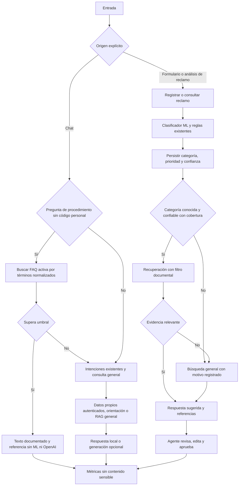

# Optimización del flujo de IA de SmartClaim AI

Fecha: 30 de octubre de 2026. Rama de trabajo: `feature/optimizacion-flujo-ia`.

Validación posterior sin créditos ni llamadas reales a modelos: [Validación sin OpenAI](VALIDACION_SIN_OPENAI.md), con 70 pruebas pytest, cinco de navegador y compilación completa. Los resultados de 47 pruebas más abajo corresponden a la implementación inicial.

## Objetivo y alcance

Atender la observación académica: una pregunta documentada no necesita clasificación ML ni generación. Los reclamos formales mantienen su clasificación, evidencia documental y aprobación humana. Se conservan React, FastAPI, SQLite, PostgreSQL/pgvector y el clasificador TF-IDF + Logistic Regression. No se incorporan LangGraph, servicios externos ni migraciones.

## Diagnóstico previo y arquitectura anterior

La auditoría focalizada encontró dos caminos diferentes, no una clasificación obligatoria para toda entrada:

- `POST /api/claims` con `analyze=true` y `POST /api/claims/{id}/analyze`: clasificación híbrida, persistencia del análisis, recuperación, generación y respuesta pendiente de revisión.
- `POST /api/chat`: detección ligera de intenciones; consultas personales y navegación mediante reglas; las demás consultas pasaban a recuperación documental y, con clave, generación OpenAI. Este camino ya evitaba el clasificador ML.

El defecto era la ausencia de búsqueda FAQ directa y de filtros documentales equivalentes en los proveedores. La categoría se añadía al texto de consulta, pero no restringía candidatos. TF-IDF podía devolver los primeros documentos aun sin similitud positiva.

Los documentos se almacenan en `documentos_base`, los fragmentos en `fragmentos_documento`, los vectores PostgreSQL en `rag_embeddings` y la evidencia de respuestas en `documentos_consultados`. Existen además índices locales TF-IDF y JSON con embeddings OpenAI.

## Arquitectura optimizada



Con RAG desactivado en la configuración existente, el reclamo utiliza la plantilla básica y mantiene la revisión humana; no recupera documentos.

## Responsabilidades

| Componente | Responsabilidad |
|---|---|
| `modules/faq_router.py` | Buscar en documentos FAQ activos mediante normalización y cobertura de términos. |
| `modules/chatbot_service.py` | Priorizar la FAQ cuando corresponde y conservar intenciones personales, orientación y generación existentes. |
| `modules/classifier.py` | Conservar predicción y reglas; señalar ejecución real del modelo para telemetría. |
| `modules/rag_engine.py` | Resolver alcance documental, conservar filtros en todos los respaldos y generar sugerencias. |
| `modules/openai_embeddings.py` | Filtrar candidatos JSON antes de similitud y descartar entradas desactualizadas. |
| `database/repositories.py` | Consulta pgvector parametrizada, restringida a documentos activos y alcance solicitado. |
| `modules/ai_trace.py` | Recoger métricas por solicitud con `ContextVar` y persistirlas en el log existente. |
| `backend/main.py` | Mantener endpoints, permisos, estados, persistencia y revisión de reclamos. |

## Criterios de enrutamiento FAQ

1. El origen prevalece: el formulario de reclamos nunca se redirige a FAQ, aunque contenga una pregunta.
2. En el chat se consideran preguntas de procedimiento con comienzos como «cómo», «cuáles son», «qué horarios» o «dónde puedo».
3. Una pregunta con código de pedido o reclamo conserva el tratamiento personal y la autorización existente.
4. Se consultan exclusivamente registros activos de tipo `FAQ` en `documentos_base`. No hay una segunda colección ni respuestas nuevas codificadas.
5. Se normalizan acentos, puntuación y palabras funcionales. Algunas variantes léxicas se agrupan, por ejemplo reembolso/devolución y contactar/comunicarse.
6. Puntuación: 75 % de cobertura de términos de la consulta en título/contenido y 25 % en título. El umbral predeterminado es `0.85`.
7. Una coincidencia suficiente devuelve el contenido íntegro, sin reformulación, con identificador, título y puntuación. No llama al clasificador, embeddings, RAG ni OpenAI.
8. Una coincidencia insuficiente conserva las rutas existentes de orientación, datos personales o consulta general. No registra un reclamo automáticamente ni afirma haber encontrado una FAQ.

La coincidencia es léxica, no comprensión semántica ni una garantía de equivalencia. Es conservadora y depende de títulos y contenido de calidad. Conviene que el administrador publique FAQs breves destinadas al cliente, con títulos representativos.

**Cobertura real:** en la SQLite auditada no existe una FAQ específica de cómo solicitar un reembolso. Esa consulta se prueba mediante una FAQ creada únicamente en una base temporal. No se agregó conocimiento ni se alteró la base del workspace para simular cobertura.

## Categorías y recuperación documental

Se reutilizan las categorías activas de `categorias_reclamo`. No se crean nuevas categorías.

- Categoría conocida + confianza igual o superior al umbral de configuración + suficientes documentos activos: alcance restringido.
- Categoría desconocida, `Soporte general`, confianza baja o cobertura insuficiente: alcance general.
- Un llamador interno que proporciona categoría sin confianza conserva compatibilidad: la categoría conocida se considera explícita; los endpoints de análisis siempre pasan la confianza y el umbral.
- Un alcance restringido sin similitud positiva puede ampliarse de forma explícita, con `no_relevant_category_results` registrado.

La confianza existente combina ML y reglas; no es una probabilidad calibrada. El umbral no convierte esa medida en una garantía estadística.

| Estrategia | Aplicación del filtro |
|---|---|
| JSON OpenAI | Filtra identificadores activos y categoría antes de calcular similitud; valida modelo, fragmento y contenido contra la base actual. |
| PostgreSQL/pgvector | `WHERE` parametrizado por categoría e identificadores, unido a documentos activos, antes de `ORDER BY` y `LIMIT`. |
| TF-IDF | Selecciona filas de la matriz por identificadores y categoría antes de calcular similitud coseno. |

Se conserva el orden de proveedores existente: JSON OpenAI, pgvector cuando está habilitado y TF-IDF como respaldo. Un error de proveedor conserva el alcance en el siguiente. Solo una ampliación explícita puede quitarlo. No se devuelven documentos arbitrarios cuando la similitud es cero.

Los resultados conservan identificadores, fragmento, título, categoría y puntuación. `guardar_respuesta` sigue registrando la evidencia en `documentos_consultados`.

La reindexación forzada ahora reconstruye los fragmentos desde los documentos activos, antes de construir el índice. Así se incorporan creaciones, ediciones y desactivaciones. Las entradas JSON antiguas se descartan al recuperar; su regeneración sigue siendo una operación explícita mediante el script existente. No se reconstruyeron índices ni se borraron datos del workspace o de producción durante este trabajo.

## Revisión humana

Se conservan los controles existentes:

- Casos de alta prioridad, críticos, baja confianza o revisión obligatoria se mantienen para atención humana.
- El agente puede editar y aprobar las respuestas sugeridas, conversar, escalar, cerrar y reabrir según sus permisos.
- No se aprueban respuestas ni se cierran casos automáticamente.
- Las preguntas FAQ no generan análisis, respuestas sugeridas ni estados de reclamos.

## Configuración

| Variable | Predeterminado | Efecto |
|---|---|---|
| `FAQ_MATCH_THRESHOLD` | `0.85` | Correspondencia mínima de FAQ; intervalo permitido 0–1. |
| `RAG_MIN_CATEGORY_DOCUMENTS` | `1` | Mínimo de documentos activos para mantener un alcance por categoría. |

Se conservan `RAG_TOP_K`, `RAG_SIMILARITY_THRESHOLD`, `USE_OPENAI_EMBEDDINGS`, `ENABLE_PGVECTOR_RAG` y la configuración de revisión/confianza existente en base de datos. `RAG_SIMILARITY_THRESHOLD` sigue correspondiendo al índice JSON; no se reinterpretan las puntuaciones de otros proveedores como equivalentes.

## Eficiencia y trazabilidad

Cada consulta de chat y análisis de reclamo registra un evento `request_completed` en `logs_sistema`, módulo `Flujo IA`. No requiere tablas nuevas. Las consultas FAQ devuelven además `sources` y `trace`, de forma aditiva al contrato anterior; el frontend existente puede ignorar estos campos.

Campos principales:

- `route`: FAQ, consulta directa, consulta, clasificación o atención humana.
- `duration_ms`: tiempo del procesamiento hasta antes de persistir la propia métrica; no incluye red del cliente.
- `ml_executed`: se alcanzó la llamada de predicción del modelo cargado. Un intento fallido puede también dejarlo en verdadero; consultar `outcome` y los respaldos.
- `rag_executed`, `retrieval_strategy`, `retrieval_attempts`.
- `category`: filtro documental efectivo; `null` significa búsqueda general.
- `classification_category`, `classification_confidence`, `human_review_required`.
- `document_count`, `openai_used`, `generation_strategy`.
- `fallback_reasons`, `outcome`.

`openai_used` indica que se intentó usar el cliente OpenAI, incluidos errores. No acredita facturación ni éxito del proveedor. `generation_strategy` diferencia generación completada de plantilla local.

No se guardan mensajes del usuario, nombre, correo, contraseña, token, prompts, fragmentos ni cuerpos de excepciones en estas métricas. Se reutiliza el identificador del reclamo para vincular el evento. Un fallo de la escritura de telemetría genera una advertencia genérica y no invalida la operación de negocio.

Ejemplo de consulta de evaluación, compatible con ambos proveedores, para analizar posteriormente el JSON fuera de la base:

```sql
SELECT fecha_log, detalle
FROM logs_sistema
WHERE modulo = 'Flujo IA' AND accion = 'request_completed'
ORDER BY id_log;
```

No hay una línea base de latencias instrumentada del sistema anterior. Por tanto no se afirma una reducción porcentual de tiempo ni se inventan resultados de precisión. La mejora comprobable es evitar RAG y OpenAI cuando una FAQ coincide; el chatbot anterior ya evitaba ML, por lo que no se le atribuye una reducción adicional de clasificación en ese camino.

## Pruebas y aislamiento

Se creó `.venv` con Python 3.11 y las dependencias existentes de `requirements.txt`. `tests/conftest.py` deshabilita la carga de `.env` antes de importar el backend, fuerza SQLite, elimina credenciales externas del entorno de pruebas y redirige base, índices y copia del modelo a rutas temporales.

Se bloquean clientes reales OpenAI, psycopg y transporte HTTP externo. Las pruebas de proveedores emplean mocks explícitos. No se usa Supabase ni se ejecutan migraciones contra bases reales.

```powershell
.\.venv\Scripts\python.exe -B -m pytest -q -p no:cacheprovider
```

Cobertura añadida:

- FAQ conocida devuelve contenido exacto y referencia, sin ML/RAG/OpenAI aun con clave simulada.
- FAQ desconocida, umbral inválido, documentos desactivados y texto de reclamo.
- Reclamos de entrega y cobro con el modelo existente, evidencia y revisión humana.
- Pregunta FAQ enviada como reclamo formal sigue ejecutando clasificación.
- Filtros en TF-IDF, JSON y consulta pgvector; respaldo sin perder categoría.
- Categoría desconocida, confianza baja, cobertura insuficiente y similitud nula.
- Actualización/desactivación de documentos y exclusión de datos sensibles en métricas.
- Regresión de login, roles, pedidos, conversaciones, catálogo, dashboard, administración, reportes y ciclo de aprobación/cierre/reapertura.

Las comprobaciones PostgreSQL prueban parámetros y orquestación mediante mocks, no una ejecución SQL contra un servidor pgvector. La verificación integrada de ese proveedor queda pendiente de una base de pruebas autorizada. Tampoco se considera la compilación frontend una prueba E2E de navegador.

Resultados verificados:

- Suite completa: **47 pruebas aprobadas** (24 existentes y 23 añadidas), 82,43 segundos en esta ejecución. Ese tiempo es de la suite, no un benchmark del producto.
- Una advertencia de deprecación de Starlette/AnyIO; no hubo fallos.
- Frontend: compilación Vite en memoria correcta, 56 salidas, sin modificar pantallas ni escribir `dist`.
- Los hashes SHA-256 de la SQLite, modelo y tres artefactos TF-IDF coinciden con los registrados antes de trabajar. Sus modificaciones locales previas siguen intactas.

## Límites y trabajos separados

Se conservan limitaciones previas de la auditoría: inicialización con escrituras en el arranque, autenticación propia, migración incompleta SQLite/PostgreSQL, configuración activa duplicada y actualización por nombre fijo. No se mezclan con esta optimización ni se ejecutan operaciones de recuperación sobre los datos actuales.

No se cambiaron pantallas, categorías, clasificador, credenciales, configuraciones de producción ni archivos binarios previos del usuario. No se realizaron commits, pushes ni despliegues.
